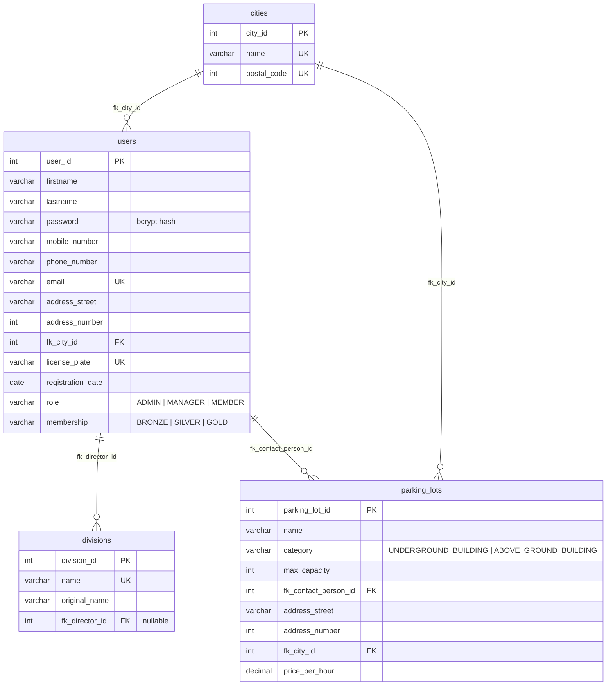

# ParkShark – Database

PostgreSQL database, versioned with **Flyway**. Migrations live in `src/main/resources/db/migration` and run
automatically at application startup, in version order. Flyway records every applied script in the
`flyway_schema_history` table.

## Diagram

## Tables

| Table          | Purpose                                                                                    |
|----------------|--------------------------------------------------------------------------------------------|
| `cities`       | Belgian cities with their postal code, shared by users and parking lots.                   |
| `users`        | Admins, managers and members. `role` sets permissions, `membership` sets the member level. |
| `divisions`    | Company divisions, each optionally led by a director (a user).                             |
| `parking_lots` | Parking lots with category, capacity, price and a contact person (a user).                 |

## Migrations

| Version | Script                                | What it does                                                                                                                                                                 |
|---------|---------------------------------------|------------------------------------------------------------------------------------------------------------------------------------------------------------------------------|
| V1      | `V1__create_initial_schema.sql`       | Creates `cities`, `users`, `divisions` and `parking_lots` with their foreign keys.                                                                                           |
| V2      | `V2__alter_table_ParkingLots.sql`     | Adds `name` and `price_per_hour` to `parking_lots`; makes its address columns `NOT NULL`.                                                                                    |
| V3      | `V3__seeds_for_all_tables.sql`        | First seed data. Now fully commented out (superseded by V5).                                                                                                                 |
| V4      | `V4__alter_table_user.sql`            | Changes `users.registration_date` from `TIMESTAMP` to `DATE`.                                                                                                                |
| V5      | `V5__altered_seeds.sql`               | Seed data matching the new date format: 10 cities, 12 users (1 admin, 4 managers, 7 members), 6 divisions, 13 parking lots. All seeded users share the same bcrypt password. |
| V6      | `V6__something.sql`                   | v6 explaination                                                                                                                                                              |                                                                                                                                                              |
| V7      | `V7__alter_table_user_membership.sql` | Adds `users.membership` (default `BRONZE`) with a check constraint allowing `BRONZE`, `SILVER`, `GOLD`.                                                                      |

## Working with Flyway

- **Never edit a migration that has already run.** Flyway stores a checksum per script and will refuse to start if it
  changes. Add a new version instead.
- Name new files `V<next number>__<short_description>.sql` (two underscores).
- To start from a clean local database, drop the schema and restart the app; all migrations will run again.